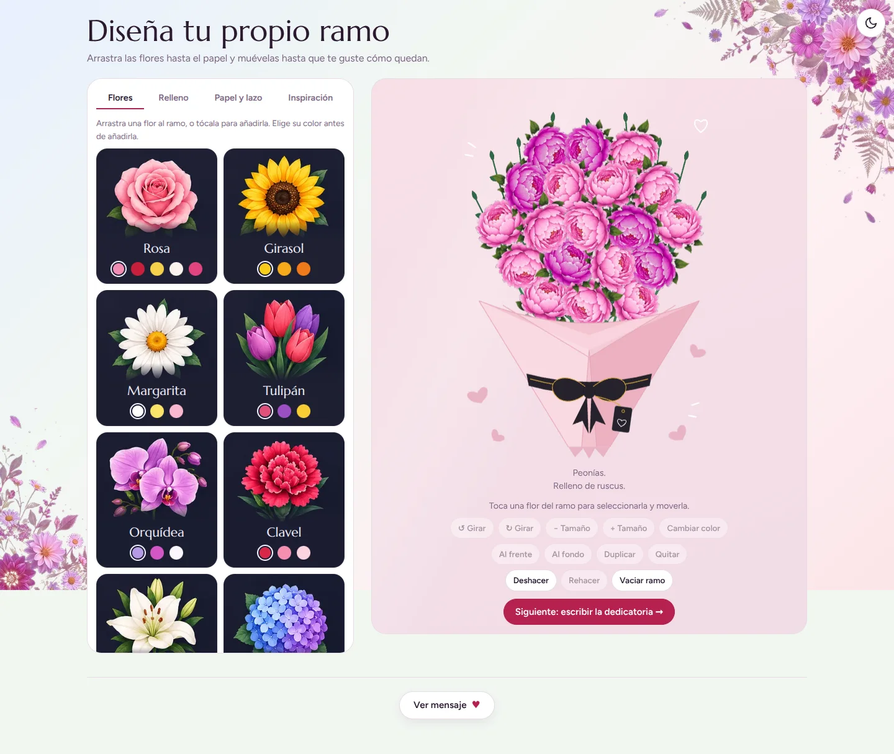
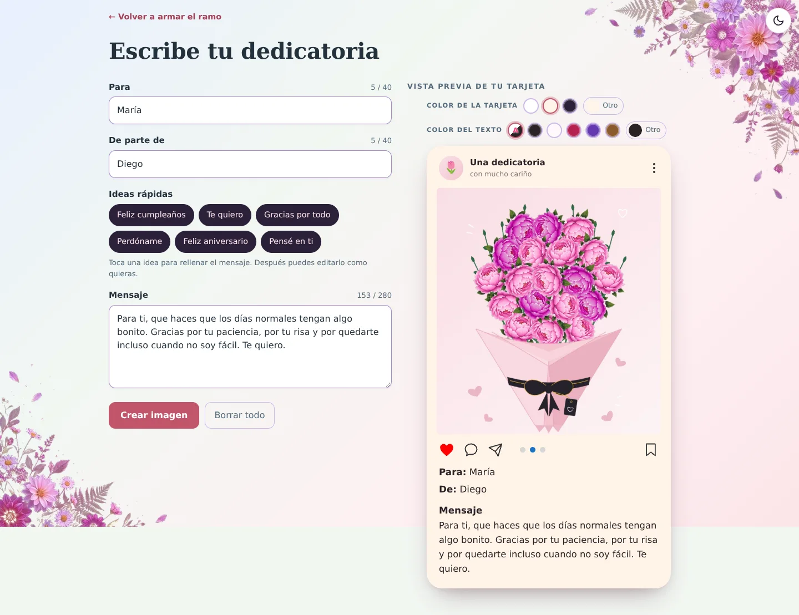
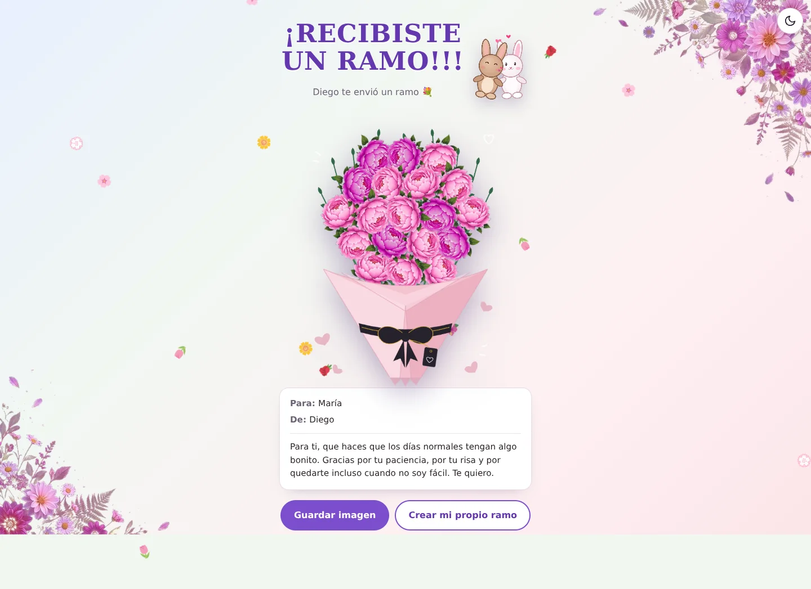
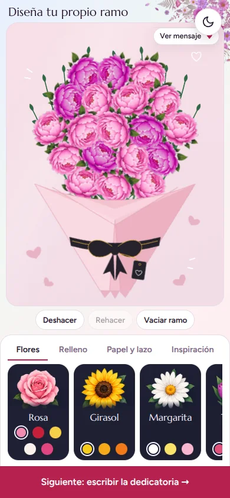

# Arma tu ramo

Arma tu ramo es una web app estática para crear un ramo de flores a tu gusto, escribir una dedicatoria y compartirlo como imagen o enlace. Todo ocurre en el navegador: no necesita backend, registro ni base de datos para el flujo normal.



## Funcionalidades

### Editor del ramo

- **12 flores** con distintas variedades de color: rosa, girasol, margarita, tulipán, orquídea, clavel, lirio, hortensia, peonía, lavanda, jazmín y dalia.
- **4 rellenos**: gipsofilia, eucalipto, helecho y ruscus.
- **7 papeles** y **5 lazos** para cambiar el acabado del ramo.
- Arrastre o toque para añadir flores, moverlas, girarlas, cambiarles el tamaño, duplicarlas, eliminarlas y ajustar su orden por capas.
- Deshacer, rehacer y vaciar el ramo.
- **13 ramos de inspiración** para empezar con una composición lista y personalizarla.
- Guardado automático del diseño en `localStorage`.
- Límite de 60 elementos por ramo.
- Modo oscuro y diseño adaptable a móvil.

### Dedicatoria

- Campos **Para** y **De parte de**, con límite de 40 caracteres cada uno.
- Mensaje de hasta **280 caracteres** con contador.
- **6 ideas rápidas** para rellenar el mensaje y editarlo después.
- Selector de color de tarjeta, color de texto y color personalizado.
- Vista previa en tiempo real dentro de una tarjeta tipo red social.
- Generación de una **imagen PNG de 1080 px de ancho** con el ramo, los nombres y el mensaje.
- Borrador, colores y tarjeta guardados localmente cuando el navegador lo permite.

### Compartir y recibir

- Descargar la tarjeta como PNG.
- Compartir la imagen con el menú nativo del dispositivo cuando está disponible.
- Generar un **enlace con el diseño y la dedicatoria incluidos**, comprimido cuando el navegador soporta `CompressionStream`.
- Vista especial para quien recibe el ramo: título, conejitos, pétalos animados, ramo, mensaje y botones para guardar la imagen o crear un ramo propio.
- Si el navegador no puede compartir archivos, se puede guardar la imagen y enviarla manualmente.

## Capturas

| Dedicatoria | Vista recibida |
| :---: | :---: |
|  |  |

<p align="center">
  
</p>

## Cómo usarlo

### Abrir el proyecto

Sirve los archivos con cualquier servidor estático. Por ejemplo:

```bash
python3 -m http.server 8000
```

Después abre `http://localhost:8000/`.

Para probar enlaces para compartir, portapapeles y otras funciones del navegador es mejor usar `http://localhost` o un sitio con HTTPS. Al abrir `index.html` directamente con `file://`, algunos navegadores restringen esas funciones.

### Generar un solo archivo HTML

```bash
node build.js
```

El resultado se escribe en `dist/arma-tu-ramo.html` e incluye el CSS, las imágenes y los recursos necesarios en un único archivo.

Opciones disponibles:

```bash
node build.js --out dist/ramo.html
node build.js --url "http://localhost:8000/?d=XXXX"
node build.js --design "BASE64_DEL_DISENO" --out dist/ramo-para-ana.html
```

Sin `--design` ni `--url`, el archivo generado abre el editor normal. Con un diseño, abre directamente la vista de ramo recibido. La carpeta `dist/` está ignorada por git.

## Estructura del proyecto

```text
.
├── index.html          # Editor, dedicatoria, tarjeta y vista recibida
├── css/
│   ├── estilos.css     # Estilos del editor
│   ├── dedicatoria.css
│   ├── guardar.css
│   └── recibido.css
├── assets/             # Ilustraciones florales del fondo
├── build.js            # Generador del HTML autocontenido
├── docs/               # Capturas usadas en este README
└── dist/               # Builds generados (ignorado por git)
```

## Privacidad

El diseño del ramo, el borrador de la dedicatoria y los colores se guardan en el almacenamiento local del navegador. La imagen se genera con `canvas` en el propio dispositivo.

Los enlaces para compartir contienen el diseño y la dedicatoria codificados en la URL. Cualquier persona que tenga el enlace puede ver esa información, así que conviene tratarlo como un enlace privado.

## Compatibilidad

Funciona en navegadores modernos de escritorio y móvil. Usa HTML, CSS y JavaScript sin frameworks. Algunas funciones mejoran según el navegador:

- **Compartir archivos**: requiere Web Share API.
- **Enlaces más cortos**: se comprimen si existe `CompressionStream`; si no, se usa el formato anterior.
- **Modo oscuro**: respeta la preferencia del sistema y permite cambiarlo manualmente.
- **Guardado local**: requiere que el navegador permita `localStorage`.
